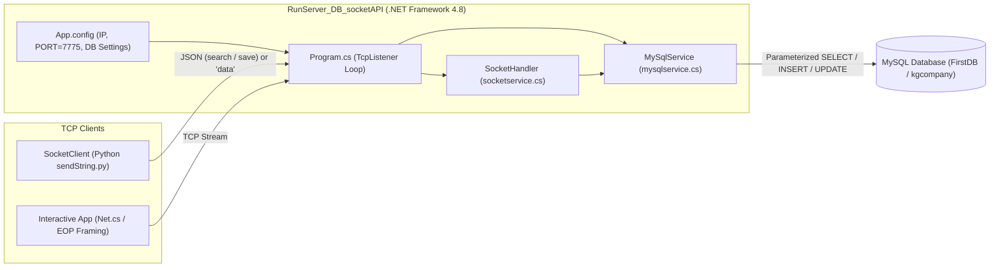

# RunServer_DB_socketAPI

> **TCP 소켓 기반 MySQL 데이터 브리지 프로토타입 서버 (v1) 및 `<EOP>` 패킷 통신 모듈**


`RunServer_DB_socketAPI`는 외부 클라이언트(Python 진단 스크립트, Unity/Kinect 인터랙티브 클라이언트, C# 단말 등)가 데이터베이스 드라이버를 직접 내장하지 않고도 **경량 TCP 소켓(`:7775`)과 JSON 메시지**만으로 MySQL 레코드를 조회(`search`)·저장(`save`)할 수 있도록 구현한 **초기(v1) TCP-DB 브리지 서버**입니다.

이후 비동기 멀티 클라이언트 아키텍처와 DI 호스팅 구조가 적용된 차세대 버전인 [`RunServer`](https://github.com/tejo1990/RunServer)(`.NET 8.0`)의 기반이 된 레포지토리입니다.

---

## 1. Why (제작 목적 및 배경)

현장 인터랙티브 콘텐츠 단말(Unity, 모션 센서/Kinect 연동 앱)이나 경량 스크립트에서 매번 DB 커넥션 풀과 자격 증명을 직접 관리하면 보안 노출 위험과 클라이언트 의존성 비대화가 발생합니다. 이를 해결하기 위해:

- **DB 자격 증명 중앙화**: `App.config`에서만 MySQL 접속 정보를 관리하고, 단말에는 지정된 TCP 포트(`7775`)와 JSON 프로토콜만 노출합니다.
- **즉각적인 조회 및 Upsert 브리지**: 단말이 `search`(ID 기반 단건 JSON 조회)와 `save`(기존 ID 존재 시 `UPDATE`, 미존재 시 `INSERT`)를 단일 TCP 패킷으로 처리할 수 있게 설계했습니다.
- **클라이언트 측 비동기 `<EOP>` 패킷 엔진 포함**: Unity/인터랙티브 앱에 이식 가능한 비동기 콜백(`BeginConnect`/`BeginReceive`) 기반 `Net.cs` 모듈을 함께 구현하여 스트림 경계 분리(`<EOP>`)와 모션/트래킹 패킷 송신을 검증했습니다.

### 연관 소켓/서버 생태계 (Related Repositories)

| 레포지토리 | 역할 및 버전 | 기술 스택 | 프로토콜 프레이밍 |
| :--- | :--- | :--- | :--- |
| **[`RunServer_DB_socketAPI`](https://github.com/tejo1990/RunServer_DB_socketAPI)** *(현재 레포)* | **v1 TCP-MySQL 브리지 프로토타입 서버 & `Net.cs` 모듈** | C# / .NET Framework 4.8 | JSON / `<EOP>` (Port `7775`) |
| [`RunServer`](https://github.com/tejo1990/RunServer) | v2 비동기 멀티 클라이언트 TCP & MySQL 세션 서버 | C# / .NET 8.0 / DI | JSON + `\n` (Port `7775`) |
| [`SocketClient`](https://github.com/tejo1990/SocketClient) | 본 서버와 연동 테스트하는 무의존성 Python 소켓 클라이언트 | Python 3 (`socket`, `json`) | Raw / JSON (Port `7775`) |
| [`SClient`](https://github.com/tejo1990/SClient) | v2 `RunServer`용 C# 비동기 CLI 클라이언트 | C# / .NET 8.0 | JSON + `\n` (Port `7775`) |
| [`servermanager`](https://github.com/tejo1990/servermanager) | `Net.cs`를 `.NET 8.0`(`mNet.cs`)으로 이식한 서버 상태 감시 데몬 | C# / .NET 8.0 | JSON + `<EOP>` (Port `7775`) |

---

## 2. What (핵심 기능 및 프로토콜 명세)

### 2.1 메인 TCP-MySQL 브리지 프로토콜 (`Program.cs` — Port `7775`)

클라이언트가 TCP 연결 후 JSON 요청을 전송하면 서버가 MySQL 쿼리를 수행하고 결과를 반환한 뒤 연결을 닫는(Request-Per-Connection) 구조로 동작합니다.

| 요청 타입 | 요청 JSON 포맷 | 동작 상세 | 응답 포맷 |
| :--- | :--- | :--- | :--- |
| **`search`** | `{"type": "search", "id": "1"}` | `MySqlService.GetItemByIdAsJson(table, id)` 호출 (`WHERE ID = @id`) | 조회된 행의 JSON 문자열 (미존재 시 `"null"`) |
| **`save`** | `{"type": "save", "data": {"id": "1", ...}}` | `MySqlService.SaveUserData(table, userData)`로 기존 ID 확인 후 동적 `UPDATE` 또는 `INSERT` 실행 | UTF-8 상태 메시지 (`"데이터가 성공적으로 저장되었습니다."`) |
| **`data`** *(보조 핸들러)* | `"data"` (`socketservice.cs` 내 `SocketHandler`) | 테이블 전체 항목을 `GetAllItemsAsJson`으로 직렬화 반환 ([`SocketClient`](https://github.com/tejo1990/SocketClient) 호환) | 전체 레코드 JSON 배열 |

### 2.2 비동기 `<EOP>` 클라이언트 네트워킹 모듈 (`Net.cs`)

콘텐츠/센서 클라이언트 연동을 위해 별도 캡슐화된 `RunServer.Net` 클래스는 1MB 수신 버퍼(`mStateObject`)와 `<EOP>`(End-Of-Packet) 구분자를 사용하여 TCP 스트림의 패킷 경계를 복원합니다.

- **연결 핸드셰이크**: 연결 즉시 `{"IF_CODE":"Device","Client":"...","Type":"..."}<EOP>` 송신
- **지원 송신 헬퍼**:
  - `Log(sMessage)` -> `{"IF_CODE":"LOG","SENTENCE":"..."}<EOP>`
  - `SendMsg(code, msg)` -> `{"IF_CODE":code,"MSG":msg}<EOP>`
  - `SendMsgAnim(code, name, motion)` -> 캐릭터 모션 동기화 패킷
  - `SendMsgLook(code, name, dir)` -> 시선 방향 제어 패킷
  - `SendMsgKinectHead(code, option, x, y, z)` -> Kinect 3축(X, Y, Z) 헤드 트래킹 좌표 패킷

---

## 3. How (아키텍처 및 코드 구조)

### 3.1 처리 흐름 다이어그램



### 3.2 주요 소스 파일 구성

```text
RunServer_DB_socketAPI/
├── App.config                # 리스닝 IP(127.0.0.1), PORT(7775), MySQL DB 접속 설정
├── Program.cs                # App.config 로드, 초기 테이블 검증 출력, TcpListener(:7775) 요청 분기 루프
├── mysqlservice.cs           # MySqlConnection 래퍼 (GetAllItems, GetItemByIdAsJson, SaveUserData Upsert)
├── socketservice.cs          # "data" 문자열 명령 수신 시 전체 테이블 JSON을 반환하는 SocketHandler
├── Net.cs                    # <EOP> 구분자 기반 비동기 Socket 상태 객체(mStateObject) 및 센서/모션 패킷 빌더
├── packages.config           # MySql.Data(9.0.0), System.Text.Json(8.0.5), LitJson(0.17.0) 패키지 명세
└── RunServer.csproj          # .NET Framework 4.8 콘솔 애플리케이션 프로젝트 정의
```

---

## 4. Quick Start (로컬 빌드 및 즉시 실행 가이드)

### 4.1 사전 요구사항

- **Windows 환경 + .NET Framework 4.8 Developer Pack** (Visual Studio 2022 또는 `msbuild` / NuGet CLI)
- **MySQL Server** (로컬 `localhost:3306`)

### 4.2 환경 설정 (`App.config`)

실행 전 `App.config` 내 데이터베이스 정보를 로컬 MySQL 환경에 맞게 설정합니다.

```xml
<appSettings>
    <add key="IP" value="127.0.0.1" />
    <add key="PORT" value="7775" />
    <add key="DB_SERVER" value="localhost" />
    <add key="DB_DATABASE" value="FirstDB" />
    <add key="DB_UID" value="root" />
    <add key="DB_PWD" value="<YOUR_MYSQL_PASSWORD>" />
    <add key="DB_TABLE" value="kgcompany" />
</appSettings>
```

### 4.3 빌드 및 실행

```powershell
git clone https://github.com/tejo1990/RunServer_DB_socketAPI.git
cd RunServer_DB_socketAPI

# NuGet 패키지 복원 및 MSBuild 컴파일 (Visual Studio Developer PowerShell)
nuget restore RunServer.sln
msbuild RunServer.sln /p:Configuration=Debug

# 서버 실행 (127.0.0.1:7775 리스닝 시작)
.\bin\Debug\RunServer.exe
```

### 4.4 클라이언트 연동 테스트 ([`SocketClient`](https://github.com/tejo1990/SocketClient) 활용)

서버 실행 상태에서 [`SocketClient`](https://github.com/tejo1990/SocketClient)의 `sendString.py`를 실행하고 프롬프트에 아래와 같이 JSON 문자열을 입력하면 즉시 MySQL 레코드를 조회할 수 있습니다.

```text
전송할 문자열을 입력하세요: {"type":"search","id":"1"}
```
